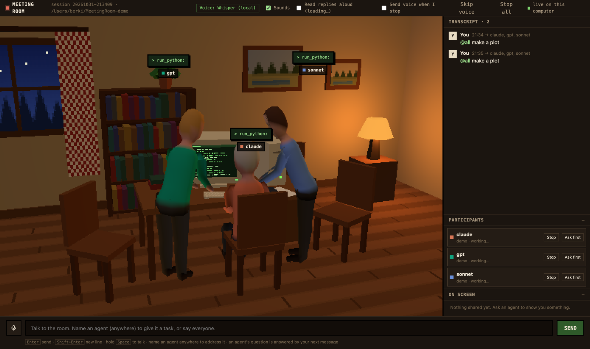

# Meeting Room

**v1.0.1** · A local, video-call style room where you hold a working meeting with
several AI agents at once: Claude Code, Codex and API models side by side. You
address them with `@name`, by typing or by talking. They do real work on **your**
computer (Python, shell, files), put plots, tables and HTML pages on a shared
screen, and answer out loud.



```
 your browser  http://127.0.0.1:8765        (reachable only from this computer)
        │ websocket
 local hub (this app, Python) ── approvals, shared screen, voice, minutes
        │
        ├── claude -p ...      Claude Code agents   (your claude.ai login)
        ├── codex exec ...     Codex CLI agents     (your ChatGPT login)
        └── HTTPS              Anthropic / OpenAI API agents (key from OS keychain)
```

---

## 1. Quick start (2 minutes)

Requirements: **Python 3.11+** (3.11 to 3.14 tested by `run.sh`), **macOS or Linux**, a recent
Chrome / Edge / Safari (**WebGL 2** and microphone access). Windows is not supported by `run.sh`;
the manual install below should work but is untested. Local speech uses MLX Whisper on Apple
Silicon and faster-whisper (CPU) elsewhere, so `requirements.txt` picks the right one for you.
Allow about 4 GB of disk for the environment and speech models (set `engine: browser` under
`voice` and `narration` to skip the downloads). Claude Code / Codex agents need those CLIs
installed and logged in (section 2); the demo agents need nothing.

```bash
git clone <this repo> meetingroom
cd meetingroom
./run.sh --demo
```

The first run creates a private `.venv` and installs everything (one time, a few
minutes; nothing goes into your system or conda Python). Your browser opens on a
room with three **demo agents** that need no login or key but really run code and
show plots. Type `@all make a plot` to see it work.

The installer prints graphics setup hints, and the browser performs a real WebGL 2
rendering check before opening the 3D view. If it fails, setup instructions and a retry
button appear. On Ubuntu, check browser graphics acceleration and your graphics drivers;
installing Python dependencies alone cannot enable browser GPU access. Run `./run.sh doctor`
for read-only Linux desktop/library diagnostics. See [Ubuntu graphics setup](docs/graphics-setup.md)
and the standalone [browser graphics test](docs/graphics-check.html).

When that works, set up real agents (section 2) and start:

```bash
./run.sh
```

You start in the **corridor** (section 4): a 3D hallway with one door per open room.
Use the *New room* door to choose who joins and where they work.

> Manual install:
> `python3 -m venv .venv && source .venv/bin/activate && pip install -r requirements.txt && python -m meetingroom run`

### Launching from the Dock (macOS)

Build the **Meeting Room.app** launcher once with `.venv/bin/python tools/build_macos_app.py`
(needs the Xcode command-line tools), double-click it and drag its icon to the Dock. It opens the
browser interface without a Terminal window, reuses this installation and models, and saves
meetings through the app's normal shutdown route when you quit. Keep the project folder in
place; rebuild with `--replace` after moving it. See [Mac launcher instructions](docs/macos-launcher.md).

---

## 2. Setting up agents

All participants are defined in **`agents.yaml`**. It never contains secrets;
the app refuses to start if it sees a key-like field. Each entry needs a `name`
(what you `@mention`) and a `provider`, plus optionally a model, colour and role.
Mix any of the providers below.

### a) Claude Code: `provider: claude-code` (recommended, no API key)

Uses the `claude` CLI and your claude.ai subscription.

1. Install Claude Code (https://docs.claude.com/claude-code), e.g. `npm i -g @anthropic-ai/claude-code`.
2. Run `claude` once in a terminal and log in.
3. Add the agent:

```yaml
  - name: claude
    provider: claude-code
    model: opus             # anything `claude --model` accepts: opus, sonnet, haiku, full IDs
    color: "#d97757"
    role: Lead analyst. Plans the work and reviews others' results.
    approval: ask           # ask = permission prompts become approval cards; auto = allow all
    # effort: high          # low | medium | high | xhigh | max (also switchable live)
    # add_dirs: [~/data]    # extra folders it may use without asking
    # permission_mode: default   # override your Claude Code default (e.g. if it is bypassPermissions)
    # claude_path: /opt/homebrew/bin/claude   # only if `claude` isn't found automatically
```

Each agent is your own Claude Code running headless in its own folder
(`workspace/agents/<name>/`), continuing one conversation across turns. It
keeps all its tools, skills, MCP servers, `CLAUDE.md` and settings. A small local
MCP bridge adds two things: permission prompts show up as **approval cards** in
the room, and a **`share_to_screen`** tool puts results on the shared screen.
Your login stays in Claude Code's own storage. If `ANTHROPIC_API_KEY` is set in
your shell it is hidden from these agents so they use your subscription.

### b) Codex CLI: `provider: codex` (no API key)

Uses the `codex` CLI and your ChatGPT login.

1. Install Codex, e.g. `npm i -g @openai/codex` or `brew install codex`.
2. Run `codex` once and sign in.
3. Add the agent:

```yaml
  - name: codex
    provider: codex
    model:                  # empty = Codex default
    color: "#10a37f"
    role: Second opinion. Independent cross-checks, HTML pages.
    network: true           # allow internet inside the sandbox (pip, curl, APIs)
    # add_dirs: [~/data]    # extra writable folders
    # sandbox: workspace-write
    # codex_path: /opt/homebrew/bin/codex
```

Codex runs in its own `workspace-write` sandbox instead of approval cards: it can
write only in its folder plus `add_dirs`.

### c) API agents: `provider: anthropic` / `provider: openai`

Billed per use via console.anthropic.com / platform.openai.com (separate from
Pro/Plus subscriptions). Store each key once in your OS keychain:

```bash
./run.sh set-key anthropic     # paste key, input is hidden
./run.sh set-key openai
./run.sh keys                  # shows masked keys and where they are stored
./run.sh remove-key openai
```

```yaml
  - name: gpt
    provider: openai           # or anthropic
    model: gpt-5.6-sol
    color: "#10a37f"
    role: Plotting and pages.
    approval: ask
```

API agents use built-in tools (`run_shell`, `run_python`, file read/write/list,
`share_to_screen`). Set the top-level `python:` to your analysis environment
(conda or venv) so they have numpy, ROOT, uproot, etc.

### d) Demo: `provider: mock`

Key-free scripted agents for trying the UI (`./run.sh --demo`).

### Choosing who joins

```bash
./run.sh                         # corridor in the browser; open rooms from there
./run.sh --agents claude,codex   # skip the picker, start only these
./run.sh --all                   # everyone in agents.yaml
./run.sh --config other.yaml     # a different roster file
./run.sh --port 9000 --no-browser
```

---

## 3. Other settings in `agents.yaml`

```yaml
# user_name: Berkin               # optional fallback; your name is asked on first launch and editable in Settings
workspace: workspace            # agent folders + meeting records; relative = inside this repo folder
python:                         # interpreter for API agents' run_python (empty = this app's)
reply_to_last_speaker: true     # un-addressed messages go to whoever spoke last

voice:                          # speech input
  engine: whisper               # whisper = local, audio never leaves the machine; browser = Chrome speech
  language: en                  # empty = auto-detect
  vocabulary: [ALPIDE, MOSS, Corryvreckan]   # domain words that help recognition

narration:                      # reading replies aloud
  engine: kokoro                # kokoro = local neural voices; browser = system voices
  speed: 1.3                    # base pace; fine-tune with the Speech speed slider in Settings
```

Per agent you can also set `voice:` (a Kokoro voice such as `am_michael`,
`bf_emma`, `bm_george`, `af_heart`) and `face:` (1-13, the 3D character; names, faces and voices are kept gender-consistent automatically).

The first start downloads the Whisper model once (~1.6 GB) and the Kokoro voices
(~340 MB). Use `engine: browser` for both to skip the downloads.

---

## 4. The corridor and settings

- **Several rooms at once.** Each open room is a wooden door; the frosted glass shows who
  sits inside and the lamp above shows its state (idle, busy, waiting for your approval).
  Click a door to step in, ✕ closes a room (agents stop, minutes are saved). The room's
  *Exit* door returns to the corridor and leaves the room running.
- **New room** (right-hand door): pick the agents (every seat has its own card; up to 4 per model, 12 in total),
  where they work (own folders, a project folder, or SSH) and an optional name for the door.
- **Previous meeting** is the fourth option under New room. Choose a saved room to
  restore its participants, roles, settings, transcript, attachments and shared screen.
  Close room / Quit asks whether to save status for later (Quit applies to all rooms).
  Native CLI session IDs and local API conversation history are retained; the transcript
  is also supplied when an agent is next addressed. Interrupted tasks and approvals are
  not replayed automatically. SSH rooms reconnect to the original host and folder.
  Atomic recovery checkpoints also survive an unexpected app exit. Rooms closed without
  saving keep their minutes but disappear from the resume list. Older meetings without
  a checkpoint can still be read through their minutes.
- **Settings** (leftmost door): read replies aloud, speech speed, the volume of agents talking
  to each other, sounds, music volume, and automatic sending of voice messages. Saved in the
  browser and applied by every room.
  Meetings are compacted automatically when closed. **Storage → Compact closed meetings now**
  also reclaims duplicate archive storage and regenerable
  PDF page images, while preserving meeting records, file contents, paths and local speech
  models. Open meetings are excluded from both deduplication and page-cache cleanup.
  Identical archived files share disk blocks;
  treat files inside a meeting's `shared/` directory as immutable snapshots and edit the
  original project outputs instead. New shares reuse identical archive copies, temporary
  uploads are removed after sharing, and page caches are cleared when a room closes.
  With the app closed, `./run.sh storage` audits reclaimable meeting storage;
  `./run.sh storage --compact` applies cleanup.
- The corridor and room pages carry a small door icon as their tab favicon.

## 5. Using the room

- **Address agents:** `@claude fit the S-curves in ~/data/run512 and plot the
  threshold map`. `@all` addresses everyone. Agents can hand work to each other
  (`@codex cross-check this`); the number of hops is capped (one reply back; up to three round trips for a **group leader**).
  Make someone leader during the meeting with the ☆ button in the Participants list or in the
  menu you get by clicking the agent in the 3D room; a leader wears a navy captain's cap.
  (`supervisor: true` in `agents.yaml` only sets the starting state.)
- **Add or remove agents** in an open room: click an agent in the 3D room and choose
  *Remove from room* (or use ✕ in the Participants list); click the chair at the PC to seat
  another agent of any configured type. Newcomers start without the earlier transcript.
- **Progress bars:** for jobs expected to take more than 5 minutes, agents call
  `report_progress` and a bar with the current stage and time left appears in the *Progress*
  panel. It clears when the agent finishes.
- **The room remembers itself:** agent positions, the jukebox and the side-panel layout
  (folded Transcript / Participants / Progress / On screen) persist when you leave and come back.
- **Voice:** hold `Space` to talk (push-to-talk) or press `Ctrl+Space` / the mic
  to toggle. Starting with a name ("Claude, can you…") becomes `@claude`.
  Local Whisper fills the main message box while you speak (live dictation). Successive decodes
  stabilize the words as more audio arrives. Silero VAD filters non-speech before decoding,
  while overlapping context preserves words across updates. Release to finalize the
  recording and use the existing auto-send setting; partial drafts are never sent.
  Recordings finish automatically at three minutes. Update dependencies with
  `pip install -r requirements.txt`; if the speech detector is unavailable, dictation
  falls back to transcribing after release. Live latency depends on the computer.
  `S` stops the current read-aloud. **Barge-in:** as soon as you start talking, whatever
  is being read aloud stops and is dropped; replies that arrive while you speak are read afterwards.
- **Approvals:** with `approval: ask`, every command or out-of-folder file access
  appears as a card showing the full command. Choose *Run it* or *Always for X*,
  or flip the tile toggle to auto-run. *Stop* / *Stop all* kill running work.
- **Voice levels:** speech between agents (an agent @-mentioning another) is read quieter than
  speech addressed to you. Adjust it under *Settings*.
- **Effort:** change an agent's reasoning effort live from its tile.
- **Shared screen** (the PC in the room; text files open in a Notepad-style window): plots (PNG/SVG), PDFs, markdown, CSV tables and sandboxed HTML pages.
  Agents can group related outputs in a clickable folder with
  `share_to_screen(paths=["plot.png", "summary.md", "dashboard.html"], title="Analysis outputs")`.
  Click an icon to open a file and **← Folder** to return. Single files still use `path`.
  Folders work for local and SSH agents and remain available in saved meetings.
- **Marking the screen:** press `M` (or *✎ Mark*) and point at part of what is shown:
  select text, or drag a box (a click marks a small area). The mark appears as a 📌 chip
  above the composer; say or type what you want and it goes along with that message, by
  default to the agent who shared the thing. Several marks can ride on one message.
  Agents receive marks token-cheaply: selected text, the text under a box in a PDF and
  file line numbers are sent as text; only a box over a picture becomes a small cropped
  PNG (≤640 px) that the agent opens only if it needs to. Click a 📌 line in the
  transcript to see that mark again. Crops are kept in `meetings/<session>/marks/`.
- **Records:** each meeting gets `workspace/meetings/<session>/` with
  `transcript.jsonl`, `details.jsonl` (every tool call behind the scenes),
  `minutes.md` (kept up to date automatically) and `shared/` (every file shown).
  `room.json` stores resumable state locally with owner-only permissions; it excludes
  configured credentials and live connection tokens. Keep the whole session folder
  and project files to preserve attachments and shared artifacts. CLI histories also
  depend on the original machine's CLI storage (or the original SSH host).
  Rebuild minutes of an old session: `./run.sh minutes workspace/meetings/<session>`.

---

### Where the meeting takes place

The start page asks where the work happens:

- **Agents' own folders** (default): each agent works in `workspace/agents/<name>/`.
- **Project folder**: pick any folder on this computer (type it or *Browse…*); every agent works there.
- **Remote over SSH**: pick a host (aliases from `~/.ssh/config` are suggested) and a folder on it.
  Claude Code and Codex agents then run *on that machine* in that folder; approval cards and the
  shared screen keep working through a reverse SSH tunnel. Requirements: key/agent based SSH (no
  password prompt), `python3`, and `claude` / `codex` installed and logged in on the remote. *Test*
  checks all of this. API and demo agents stay local and are told to reach the project with `ssh`.

Without the picker: `./run.sh --project ~/analysis` or `./run.sh --ssh mybox --project ~/work`.
The header in the room shows the active location.

## 6. Security

- **Nothing is hosted.** The server binds to `127.0.0.1` only; non-localhost
  `Host` headers are rejected (blocks DNS rebinding).
- **Fresh access token on every start**, carried in the printed link and removed
  from the address bar. Other origins and token-less connections are refused.
- **API keys live only in the OS keychain** (macOS Keychain, Windows Credential
  Manager, Linux Secret Service), never in files, logs, transcripts or the
  browser. Plaintext keyrings are refused.
- **Agent HTML runs sandboxed** and cannot reach the app or your session.
- **OpenAI calls use `store=False`.**
- Remember: whatever an agent reads (files, command output) is sent to its model provider.

---

## 7. Troubleshooting

| Problem | Fix |
|---|---|
| `Claude Code not found` | Set `claude_path:` for that agent (see `which claude`). |
| `Codex CLI not found` | Set `codex_path:` (see `which codex`). Over SSH, set `remote_codex_path:` if Codex lives somewhere a login shell doesn't see; *Test* on the host shows what was found. |
| No approval cards for Claude Code | Your Claude Code default is probably `bypassPermissions`; set `permission_mode: default`. |
| `no openai API key` | `./run.sh set-key openai` |
| Mic does nothing | Allow microphone access in the browser; the first Whisper start is slow (model download). |
| Port in use | `./run.sh --port 8766` |
| Changed `agents.yaml` | Restart the room. |
| Custom character faces | `.venv/bin/pip install pillow && .venv/bin/python tools/make_faces.py <photo folder>` |

---

## 8. Project layout

```
agents.yaml              participants and settings (no secrets)
run.sh                   one-command launcher (creates .venv on first run)
requirements.txt
meetingroom/
  __main__.py            CLI: run, set-key, keys, remove-key, minutes
  server.py              local hub: routing, approvals, shared screen, guards
  annotate.py            marks on the shared screen: text/line/PDF-text anchors, image crops
  agents.py              agent loop; claude-code / codex / anthropic / openai / mock backends
  mcp_bridge.py          MCP server giving CLI agents approvals + share_to_screen
  tools.py               built-in tools for API agents
  picker.py              the corridor page: room doors, settings, new-room setup
  stt.py, tts.py         local Whisper transcription, Kokoro narration
  minutes.py             details.jsonl + minutes.md
  saved.py               recovery checkpoints and saved meetings
  storage.py             meeting compaction and storage audit
  launcher.py            readiness state used by the macOS launcher
  keys.py                OS keychain access
  static/                room UI (index.html, room3d.js, live-dictation.js), corridor3d.js, favicon, faces, three.js
tools/make_faces.py      turn portrait photos into character faces
tools/build_macos_app.py build the Dock launcher (macOS)
tests/                   `python -m pytest tests` (Python) and `node tests/*.mjs` (front-end checks)
```

## Changelog

- **1.0.1**: check browser WebGL 2 before entering the 3D view; show Ubuntu graphics
  repair steps and downloadable diagnostics; add `./run.sh doctor` and a standalone
  browser graphics test. New default workspace is `workspace/` inside the cloned repo,
  including demo data. Existing home-directory data is preserved and is not moved
  automatically; see [upgrade notes](docs/release-v1.0.1.md) before restarting.

- **1.0.0**: first stable release. Names, faces and voices follow the model type (OpenAI agents
  are always female, Claude agents male, voice gender matches the face); leaders set during the
  meeting, with a cap; add and remove agents in open rooms; per-seat cards and 13 faces;
  progress bars for long jobs; thinking-activity bubbles; folders of several files on the PC,
  Windows-98 style with a Notepad viewer; live Whisper dictation with Silero VAD; room state
  (positions, music, panels) persists; music volume and speech speed settings; automatic
  compaction of closed meetings; macOS Dock launcher; the exit door always returns to the corridor.

- **0.5.0** (2026-11-01): settings door and screen in the corridor; agent-to-agent speech
  plays quieter (adjustable); barge-in stops read-aloud when you start talking; Codex over
  SSH is found in npm/nvm locations; tab favicon. Saved meetings and atomic recovery
  checkpoints restore participants, conversation, attachments and the shared screen;
  attach files by picking, dropping or pasting them; sharper PDF rendering.
- **0.4.0**: corridor with one door per room, several rooms running at once.
- **0.3.0**: marking the shared screen (text, boxes, PDF text) and sending marks to agents.
- **0.2.x**: local-only fixes and polish, SSH/project-folder locations.

- **0.1.0** (2026-10-31): first release. Claude Code, Codex, Anthropic and OpenAI
  agents; 3D room; approval cards; shared screen; local Whisper voice input and
  Kokoro narration; live effort switching; participant picker; automatic minutes.

## Several instances of one model

In the new-room picker every seat has its own card (for example `sonnet`, `sonnet-2`, `sonnet-3`), or run
`./run.sh --agents claude,sonnet,sonnet`. Extra seats get handles `sonnet-2`, `sonnet-3` and keep the model's
shirt colour with their own face. Every agent also has a fixed human first name per model type (override with
`person:` in `agents.yaml`); address by name ("Mateo, plot this") or by `@handle`.
